<div align="center">

# 👁️ DR Triage Platform

**Offline, quality-gated, explainable, uncertainty-aware diabetic retinopathy triage for rural primary health centres.**


*BIS586 Mini Project · Group 10 · Guide: Prof. Krupesha*

[**Quick start**](#-quick-start-local) · [**How it works**](#-how-it-works) · [**Results**](#-results) · [**Roles & portals**](#-roles--portals) · [**API**](#-api-reference) · [**Development**](#-development-workflow) · [**Limitations**](#-limitations)

</div>

> ⚠️ **Research prototype, not a medical device.** The AI output is *supporting evidence for a clinician*. It is never a diagnosis, and the final decision is always the doctor's.

---

## 📑 Contents
1. [What problem does this solve?](#-what-problem-does-this-solve)
2. [Choose your path](#-choose-your-path)
3. [How it works](#-how-it-works): architecture, workflow, quality gate, triage logic, sync
4. [Quick start (local)](#-quick-start-local)
5. [Accounts, centres and passwords](#-accounts-centres-and-passwords)
6. [Roles & portals](#-roles--portals)
7. [Safety rules and where they are enforced](#-safety-rules-and-where-they-are-enforced)
8. [Machine-learning pipeline](#-machine-learning-pipeline)
9. [Results](#-results): internal test, external validation, robustness
10. [Data model](#-data-model)
11. [API reference](#-api-reference)
12. [Development workflow](#-development-workflow)
13. [Project structure](#-project-structure)
14. [Limitations](#-limitations)
15. [Operations: backups, monitoring, AI worker, migrations, security](#-operations)
16. [Troubleshooting & FAQ](#-troubleshooting--faq)

---

## 🎯 What problem does this solve?

Diabetic retinopathy (DR) is a leading cause of preventable blindness, but eye specialists are scarce in rural areas. A health worker can photograph the retina; the hard part is knowing **which photos are usable** and **which patients need a specialist first**. This platform:

| Challenge in the field | What the platform does |
|---|---|
| Poor photos (blur, dark, glare, off-centre, over-compressed) | A **quality gate** blocks unreadable images *before* any AI runs, and tells the nurse exactly how to retake them |
| No reliable internet | The nurse app works **fully offline** and syncs later, with duplicate protection and checksum verification |
| AI that is overconfident or a black box | **Calibrated** probabilities, an explicit **Uncertain** state, and **Grad-CAM++** heatmaps showing where the model looked |
| Trust and accountability | AI result is **immutable**; the doctor's decision is a **separate, append-only** record; every action is in a **tamper-evident audit chain** |
| Many staff and several centres | Every person has **their own login**; staff see **only their own health centre**; the nurse **chooses which doctor** gets each case |
| Patients left uninformed | Patients see only the **doctor-reviewed** report, in plain language, with the heatmap |

## 🧭 Choose your path

| I am a… | Start here |
|---|---|
| **Reviewer / examiner** | [How it works](#-how-it-works) → [Results](#-results) → [Safety rules](#-safety-rules-and-where-they-are-enforced) |
| **Developer** | [Quick start](#-quick-start-local) → [Development workflow](#-development-workflow) → [API reference](#-api-reference) |
| **Clinician / user** | [Roles & portals](#-roles--portals) → [Limitations](#-limitations) |

---

## 🔬 How it works

### 1. System architecture

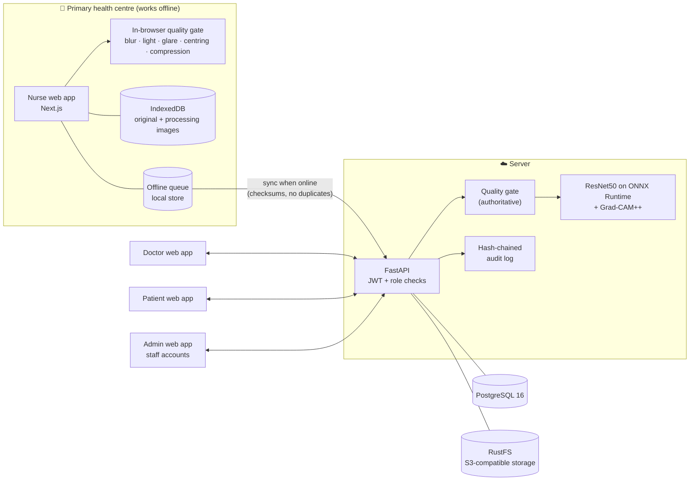

### 2. The screening workflow, end to end

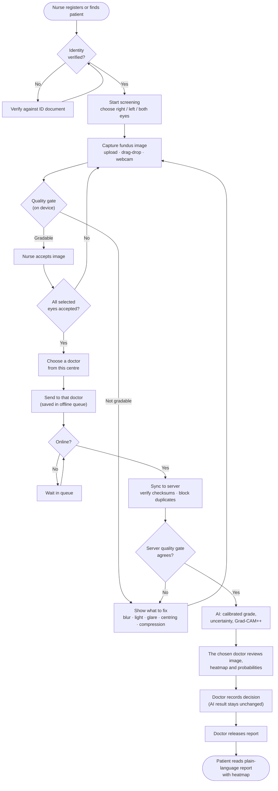

### 3. The quality gate

An image must pass **every** check. The same rules run in the browser (so nurses get instant feedback offline) and on the server (which has the final say).

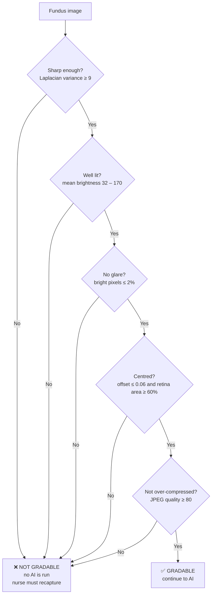

> **Why a compression check?** Heavy JPEG compression leaves sharpness, brightness and centring untouched, so the other checks cannot see it, yet it collapses accuracy (QWK 0.78 → 0.13 at quality 10). The check reads the quantisation table straight from the file header. See [Results](#-results).

### 4. From probabilities to a triage outcome

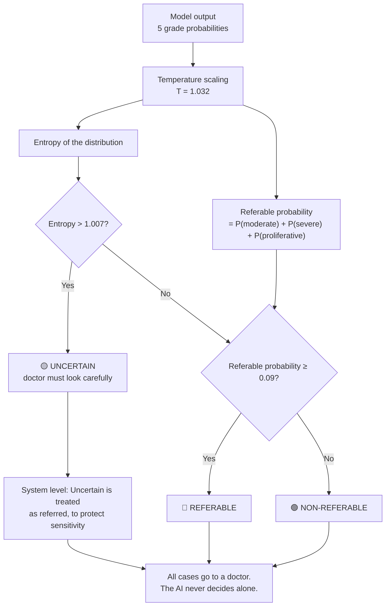

The low referable threshold (0.09) is deliberate: it was set on the validation set to reach a sensitivity target of 93%. A patient can therefore be graded "No DR" and still be flagged *Referable*, because a small but non-trivial probability of disease is enough to ask a doctor to look.

### 5. Offline sync, step by step

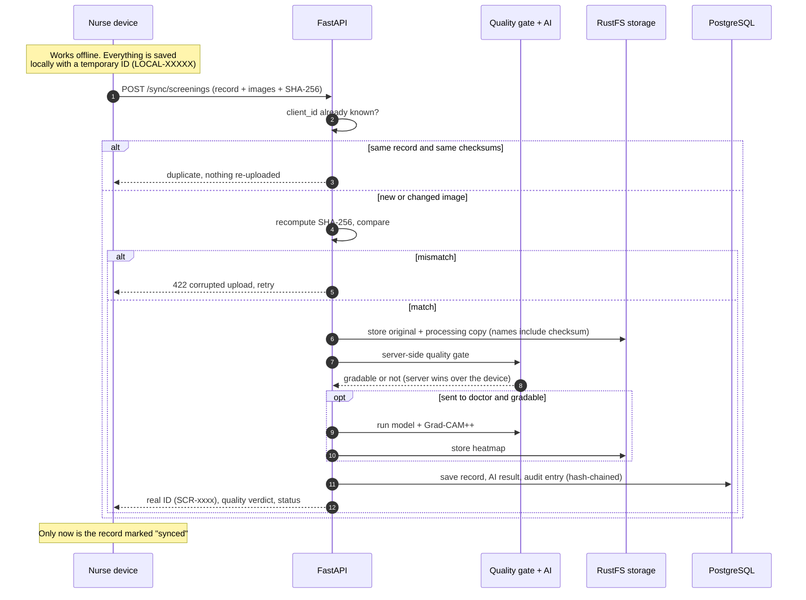

### 6. Eye and screening states

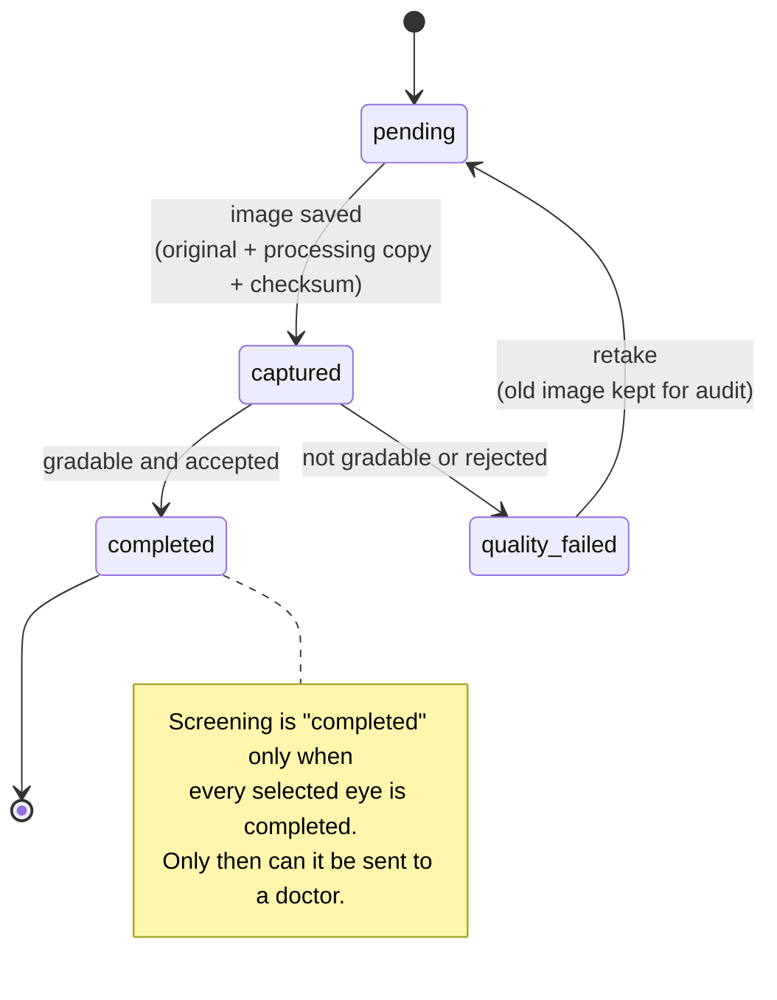

---

## 🚀 Quick start (local)

### Prerequisites
- **Python 3.11+**, **Node.js 20+**, **Docker Desktop**
- The trained model files in `backend/model/`: `dr.onnx`, `best.pt`, `calib.json` (not stored in git, see [Development workflow](#-development-workflow))

### 1. Start the database and image storage
```bash
cd backend
docker compose up -d
```
This starts PostgreSQL (host port **5433**) and RustFS storage (**9000** API, **9001** console, login `minioadmin` / `minioadmin`).

### 2. Start the API and the AI worker
```bash
cd backend
pip install -r requirements.txt
python -m uvicorn main:app --reload      # terminal 1: the API
python worker.py                         # terminal 2: runs the AI on uploaded cases
```
The API answers uploads immediately and the worker does the AI in the background. For a single-terminal setup set `AI_MODE=inline`.
Interactive API docs: **http://127.0.0.1:8000/docs**

### 3. Start the web app
```bash
cd frontend
npm install
echo NEXT_PUBLIC_API_URL=http://127.0.0.1:8000 > .env.local
npm run dev
```
Open **http://localhost:3000**.

<details open>
<summary><b>🔑 First sign-in: there are no default passwords</b></summary>

On the **first start with an empty database**, the API terminal prints a table of demo accounts, each with a **random temporary password shown only once**. Copy it from the terminal. Everyone is forced to choose their own password at first sign-in.

| Account | Role | Centre |
|---|---|---|
| `admin1` | Centre administrator | PHC-001 Kolar Rural PHC |
| `nurse1`, `nurse2`, `doctor1` | Nurses and doctor | PHC-001 |
| `P001`, `P002`, `P003` | Patients | PHC-001 |
| `admin2` | Centre administrator | PHC-002 Mulbagal PHC |
| `nurse3`, `doctor2` | Nurse and doctor | PHC-002 |
| `P004`, `P005`, `P006` | Patients | PHC-002 |

Missed the table? Issue a new temporary password from the `backend` folder:
```bash
python manage.py reset-password nurse1
python manage.py reset-patient P001
```
Details are in [Accounts, centres and passwords](#-accounts-centres-and-passwords).
</details>

> 🐳 **One-command Docker setup** for the whole stack (database, storage, API and web app) is being added. Until then, use the steps above.

### 🧪 Try the whole journey in 10 minutes

- [ ] **Admin** (`admin1`): sign in with the temporary password, choose your own → *Staff Accounts* → add a nurse and note the one-time password
- [ ] **Nurse** (`nurse1`): *Patient Registration* → register a patient and note the **patient ID and temporary password** → *Patient Verification* → *Start screening* → capture both eyes (use images from `data/proc512`) → accept → *Screening Results* → **Send to doctor**, choosing a doctor → *Offline Queue & Sync* → **Sync all now**
- [ ] **Doctor** (the one you chose): open *Screening Review*, see the image with the **real Grad-CAM++ heatmap** → *Decision* → change a grade without a reason (the server refuses) → add a reason → save → *Reports* → **Release to patient**
- [ ] **Patient** (the new patient ID): sign in with the temporary password, set your own, open *My Report* for the plain-language result and heatmap
- [ ] **Isolation check**: sign in as `nurse3` (the other centre). The patient list does not contain PHC-001's patients, and `doctor2` never sees the case
- [ ] **Doctor** → *Audit Trail* shows a green **Chain verified** banner
- [ ] **Offline test**: set the browser's network to *Offline*, screen another patient (the doctor list is remembered), then go back online and watch the queue upload by itself

---

## 🔐 Accounts, centres and passwords

Every nurse, doctor, administrator and patient belongs to **one health centre**. Staff can only see patients, screenings and appointments of their own centre, and this is checked **on the server**. Nobody chooses their own first password: the system issues a **random temporary password, shown once**, and the person must replace it at first sign-in.

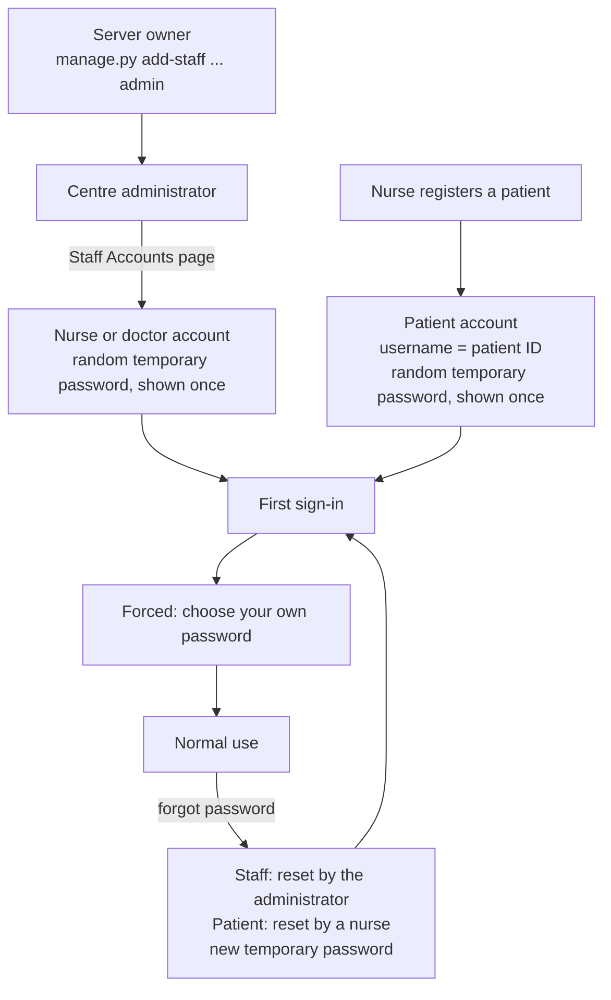

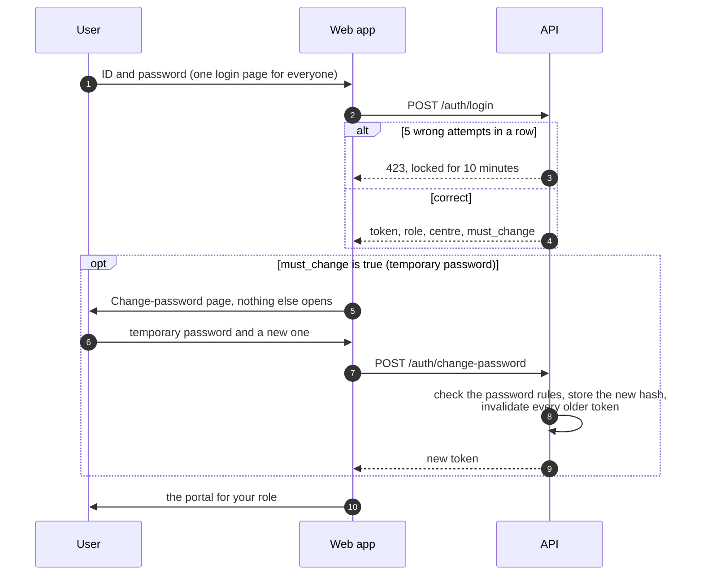

**Who creates and resets what**

| Who | Can do |
|---|---|
| Server owner (`manage.py`) | Create centres, the first administrator, reset any password |
| Centre administrator (web) | Create nurses and doctors of their centre, reset their passwords, disable or re-enable them |
| Nurse (web) | Register patients (gets the patient's temporary password), reset a patient's password |
| Doctor, patient | Change their own password |

```bash
# from the backend folder, database running
python manage.py add-centre PHC-003 "Bangarpet PHC" --district Kolar
python manage.py add-staff admin3 admin "Centre Admin" --centre PHC-003
python manage.py add-staff nurse.divya nurse "Nurse Divya" --centre PHC-001
python manage.py reset-password nurse.divya
python manage.py reset-patient P001
python manage.py deactivate nurse.divya
python manage.py list
```

**Password rules** (checked on the server; the page shows them live)

| Rule | Detail |
|---|---|
| Length and mix | At least 10 characters, with letters and numbers |
| Not guessable | Must not contain your ID or username, common words (such as *password* or *welcome*) or repeated characters |
| Fresh | Must differ from the old password |
| Lockout | 5 wrong attempts lock the account for 10 minutes |
| Sessions | Changing or resetting a password ends all older sessions; disabling an account does too |
| Storage | Salted PBKDF2-SHA256 hashes, never the password itself |

**Sending a case to a doctor.** After every selected eye is accepted, the nurse picks a doctor from the list of active doctors **in her centre**. Only that doctor sees the case. The nurse can change the doctor until the review is recorded. The doctor list is remembered on the device, so choosing works offline too.

---

## 👥 Roles & portals

```mermaid
flowchart LR
    subgraph NURSE["🩺 Nurse / screening operator"]
        n1["Register & verify patients"]
        n2["Capture + quality check + recapture"]
        n3["Results, offline queue & sync, history"]
        n4["Confirm appointment requests"]
    end
    subgraph DOCTOR["👨‍⚕️ Doctor"]
        d1["Review queue, sorted by urgency"]
        d2["Image + Grad-CAM++ + probabilities"]
        d3["Decision, report release"]
        d4["Analytics, quality dashboard, audit trail"]
    end
    subgraph PATIENT["🧑 Patient"]
        p1["Own profile and history"]
        p2["Plain-language report + heatmap"]
        p3["Appointments, notifications, help"]
    end
    subgraph ADMIN["🛠️ Centre administrator"]
        a1["Create nurse and doctor accounts"]
        a2["Issue temporary passwords, disable accounts"]
    end
    ADMIN -. "creates accounts" .-> NURSE
    ADMIN -. "creates accounts" .-> DOCTOR
    NURSE -- "sends case to the chosen doctor" --> DOCTOR
    DOCTOR -- "releases report" --> PATIENT
```

<details>
<summary><b>Who can see what (click to expand)</b></summary>

| Information | Nurse | Doctor | Patient | Admin |
|---|:-:|:-:|:-:|:-:|
| Patients of **their own centre** | ✅ | ✅ | own only | ❌ |
| Quality results and recapture guidance | ✅ | ✅ | ❌ | ❌ |
| **AI probabilities, grade, uncertainty** | ❌ | ✅ *(cases assigned to them)* | ❌ | ❌ |
| Grad-CAM++ heatmap | ❌ | ✅ | ✅ *(after release)* | ❌ |
| Doctor decision and notes | ❌ | ✅ | ✅ *(after release)* | ❌ |
| Audit trail and analytics | ❌ | ✅ *(own centre)* | ❌ | ❌ |
| Staff accounts | ❌ | ❌ | ❌ | ✅ *(own centre)* |

Roles and centres are enforced **on the server** with JWT tokens, not just hidden in the interface. A request for another centre's record returns *not found*, so its existence is not revealed.
</details>

---

## 🛡️ Safety rules and where they are enforced

| Rule | In the browser | On the server |
|---|---|---|
| Verify the patient before screening | Verification step required | `409` if the patient is not verified |
| Left and right eyes tracked separately | Per-eye state | One `eye_records` row per eye |
| **An ungradable image never reaches the AI** | Accept button is disabled; only *Reject & recapture* | Server re-runs the gate and **overrules the device**; AI runs only on accepted, gradable eyes |
| AI is supporting evidence only | Warning banners; doctor decides | AI result stored once, never edited; decisions are separate rows |
| Overriding the AI needs a reason | Form validation | `422` if the grade differs from the AI and notes are empty |
| Original image preserved, separate processing copy | Both stored in IndexedDB | Two objects in storage; names include the checksum, so a retake never overwrites |
| A record is not "synced" until sync succeeds | `synced` flag | `synced_at` set only after a successful commit |
| Duplicate uploads prevented | `client_id` per screening | Unique `client_id`; unchanged checksums are skipped |
| Image lineage is auditable | SHA-256 per image | Checksums in audit entries; **hash-chained** log detects tampering |
| Patients see only reviewed results | Report page | Patient endpoints return only released, doctor-reviewed data; **no probabilities** |
| Staff see only their own centre | Lists and pages show one centre | Every query is filtered by the caller's centre; other centres' records return `404` |
| Only the chosen doctor reviews a case | Doctor queue shows assigned cases | Review and release return `403` for any other doctor |
| No shared or weak passwords | Live rules on the change-password page | Temporary passwords are random and single-use, rules enforced, 5-attempt lockout, old tokens invalidated |

---

## 🧠 Machine-learning pipeline

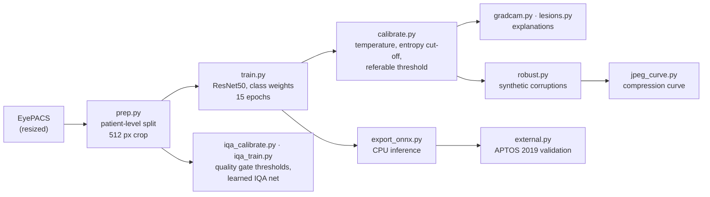

| Choice | Value |
|---|---|
| Model | ResNet50 (timm), 5-class grading, input 384 px from 512 px preprocessed images |
| Imbalance handling | Class weights; patient-level train/val/test split (no patient in two splits) |
| Calibration | Temperature scaling, `T = 1.032` |
| Uncertain state | Entropy cut-off `1.007` |
| Referable | Grade ≥ 2; probability threshold `0.09` (validation sensitivity target 93%) |
| Explanation | Grad-CAM++ on `layer4[-1]`; optional lesion-level module |
| Inference | ONNX Runtime on CPU (no GPU needed in the clinic) |

Scripts live in `src/`; run them from the project root as `python src/<script>.py` (if an import error appears, run from inside `src/`). Large outputs (`best.pt`, `dr.onnx`, `calib.json`) go in `outputs/` and are copied to `backend/model/`.

---

## 📊 Results

### Internal test set (EyePACS)

| Measure | Value |
|---|---|
| 5-class QWK | **0.774** |
| Referable AUROC | **0.941** |
| Calibration error (ECE) | 0.038 (target < 0.05) |
| Referable sensitivity / specificity at threshold 0.09 | **0.914** / 0.770 |
| Uncertain cases | 9.8% |
| Referral rate (referable or uncertain) | 36.2% |

### External validation (APTOS 2019, 3,662 images, frozen model, no re-tuning)

| Measure | Internal | External |
|---|---|---|
| Referable AUROC | 0.941 | **0.971** (95% CI 0.966–0.975) |
| Sensitivity | 0.914 | **1.000** |
| Specificity | 0.770 | **0.711** |
| 5-class QWK | 0.774 | 0.869 |
| Calibration error (ECE) | 0.038 | 0.140 |
| Quality gate rejection | 7.1% | 2.2% |

<details>
<summary><b>How to read this honestly (click to expand)</b></summary>

- The model finds nearly all referable patients at a new hospital, but it **grades about one level too high** on APTOS (80% of mild cases were called moderate). That keeps the referral decision safe but lowers specificity (more unnecessary referrals).
- Higher AUROC and sensitivity on APTOS reflect a different severity mix and a **referable prevalence of 40.6%**, not a better model.
- Confidence is **overconfident** on the new population (ECE 0.038 → 0.140). A site-specific recalibration is recommended before any deployment, and the doctor-review step stays.
- The cause of the grade shift (grading convention versus camera or population) cannot be separated with this data.


</details>

### Robustness to image damage

| Condition | QWK | AUROC | Gate rejects | QWK on accepted images |
|---|---|---|---|---|
| clean | 0.781 | 0.941 | 7.1% | 0.794 |
| blur | 0.442 | 0.814 | 100% | n/a |
| low light | 0.682 | 0.925 | 83% | 0.805 |
| over-exposed | 0.584 | 0.799 | 44% | 0.701 |
| off-centre | 0.767 | 0.939 | 100% | n/a |
| low resolution (96 px) | 0.595 | 0.850 | 100% | n/a |
| JPEG quality 10 | 0.127 | 0.645 | 5.6% | 0.143 |

The gate protects the model: on low-light and over-exposed images, accuracy on the images it lets through is clearly higher than on all images. **JPEG compression slipped through the original gate**, which is why the compression check was added.

### JPEG compression curve

| JPEG quality | 95 | 90 | **80** | 70 | 60 | 50 | 40 | 30 | 20 | 10 |
|---|---|---|---|---|---|---|---|---|---|---|
| QWK | 0.773 | 0.790 | **0.740** | 0.706 | 0.687 | 0.626 | 0.543 | 0.474 | 0.329 | 0.127 |
| AUROC | 0.941 | 0.939 | **0.935** | 0.921 | 0.910 | 0.890 | 0.843 | 0.811 | 0.743 | 0.645 |

Rule fixed in advance: accept a level if QWK falls by at most 0.05 and AUROC by at most 0.02 from the clean baseline. Quality **80** is the lowest that passes, so files below it are rejected. Differences of about ±0.02 between neighbouring levels are sampling noise (1,200 images).


### Explainability


---

## 🗃️ Data model

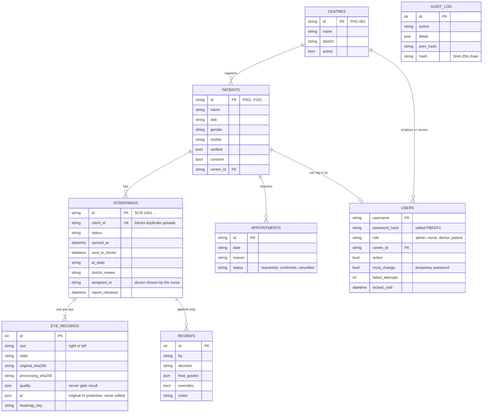

The **audit log** is separate and hash-chained: each row stores the hash of the previous one, so editing or deleting any row breaks the chain, which the Audit page reports.

---

## 🔌 API reference

Interactive docs (try it from the browser): **http://127.0.0.1:8000/docs**. Click **Authorize** and paste the token returned by `/auth/login`.

<details>
<summary><b>All endpoints (click to expand)</b></summary>

| Area | Endpoint | Who |
|---|---|---|
| Auth | `POST /auth/login` · `POST /auth/change-password` · `GET /me` | public / any signed-in user |
| Patients | `GET /patients` · `GET /patients/{id}` | nurse, doctor (own centre) |
| Registration | `POST /patients` (duplicate check, returns the temporary password once) · `POST /patients/{id}/verify` · `POST /patients/{id}/reset-password` · `GET /doctors` | nurse |
| Admin | `GET /admin/staff` · `POST /admin/staff` · `POST /admin/staff/{username}/reset-password` · `POST /admin/staff/{username}/active` | admin |
| Appointments | `POST /appointments` · `GET /appointments` · `POST /appointments/{id}/cancel` · `POST /appointments/{id}/confirm` | patient / staff |
| Sync | `POST /sync/screenings` (multipart: JSON + images) | nurse |
| Screenings | `GET /screenings` · `GET /screenings/{id}` · `GET /patients/{id}/screenings` | role-aware |
| Assignment | `POST /screenings/{id}/assign` (change doctor until reviewed) | nurse |
| Doctor | `POST /screenings/{id}/reviews` · `POST /screenings/{id}/release` · `GET /analytics` | doctor |
| Audit | `GET /audit` · `GET /audit/verify` | doctor |

Every staff endpoint is limited to the caller's own centre. Responses are **role-aware**: the same screening returns different fields to a nurse, a doctor and a patient.
</details>

---

## 🛠️ Development workflow

<details open>
<summary><b>Day-to-day: the fast loop</b></summary>

Keep the database and storage in Docker, and run the API and web app directly so code changes reload instantly:

```bash
cd backend && docker compose up -d        # once
python -m uvicorn main:app --reload       # API reloads when you save a Python file
cd frontend && npm run dev                # web app reloads when you save a file
```
</details>

<details>
<summary><b>Things that need a little care when you change the project</b></summary>

| You changed… | What to do |
|---|---|
| Python or TypeScript code | Nothing in the fast loop. After a Docker build, rebuild the image (`docker compose up --build`) |
| **Database tables** (`models.py`) | Make a migration: `python backup.py run`, then `alembic revision --autogenerate -m "what changed"`, read the new file in `migrations/versions/`, then `alembic upgrade head` |
| `NEXT_PUBLIC_API_URL` | Next.js bakes it in at build time, so restart `npm run dev` (or rebuild the web image) |
| The model or calibration | Replace the files in `backend/model/`, restart the API |
| JPEG threshold | Change **both** `backend/jpegq.py` (`MIN_QUALITY`) and `src/lib/jpegq.ts` (`MIN_JPEG_QUALITY`) |
| Quality-gate thresholds | Change both `backend/iqa.py` and `frontend/src/lib/iqa.ts` so device and server agree |
| Secrets | Run `python secrets_check.py`; never commit `.env` files (see Operations → Secrets). Demo accounts use random temporary passwords |
| Password rules | Change both `policy_error` in `backend/auth.py` and the rules list in `frontend/src/app/change-password/page.tsx` |
| Anything that changes behaviour | Run `pytest` in `backend`; CI runs it on every push |
</details>

**Model files are large and are not committed.** Keep `outputs/*.pt` and `*.onnx` out of git (use Git LFS or a release asset), and commit only the small figures in `docs/figures/`.

**Before a demo or review, tag the working version** so you can always return to it: `git tag review-3`.

---

## 📁 Project structure

```
dr-triage/
├─ requirements.txt        backend dependencies
├─ requirements-ml.txt     extra packages for training scripts
├─ src/                    ML pipeline (prep, train, calibrate, gradcam, robust, external, jpeg_curve, ...)
├─ data/                   datasets and splits            (not in git)
├─ outputs/                trained model + result tables   (large files not in git)
├─ docs/figures/           figures used in this README
├─ docs/COMPLIANCE.md      intended use, CDSCO, ICMR, DPDP notes
├─ docs/RUNBOOK.md         what to do when something goes wrong
├─ .github/workflows/ci.yml  tests, build, secret and dependency scan
├─ backend/
│  ├─ main.py              app, seed data, startup
│  ├─ models.py            database tables
│  ├─ auth.py              password hashing, JWT, role checks
│  ├─ routes_auth.py · routes_people.py · routes_admin.py · routes_screenings.py
│  ├─ manage.py            admin CLI: centres, staff, password resets
│  ├─ pipeline.py          preprocessing, ONNX inference, Grad-CAM++
│  ├─ iqa.py · jpegq.py    server-side quality gate
│  ├─ audit.py · storage.py · paging.py · settings.py
│  ├─ ai_jobs.py · worker.py       background AI queue and its worker process
│  ├─ backup.py · secure_backup.py · monitor.py · logging_setup.py · secrets_check.py
│  ├─ migrations/          Alembic database migrations
│  ├─ tests/               pytest suite (auth, centres, flow, security sweep, AI queue, scaling)
│  ├─ logs/                api.log, worker.json   (not in git)
│  ├─ model/               dr.onnx · best.pt · calib.json
│  └─ docker-compose.yml   PostgreSQL + RustFS
└─ frontend/
   └─ src/
      ├─ app/{nurse,doctor,patient,admin}/   the four portals, plus login and change-password
      ├─ components/                   shared UI (sidebar, viewer, ...)
      └─ lib/                          db.ts (offline store + sync), api.ts, auth.ts, iqa.ts, jpegq.ts
```

---

## ⚠️ Limitations

- **Research prototype.** Not validated clinically and not a regulated medical device.
- **One external dataset**, image-level resampling, different grading convention and prevalence; confidence needs recalibration at a new site.
- The model tends to **over-grade** on APTOS (safe for triage, but increases referrals).
- **Compression check** cannot judge lossless files that were earlier saved as low-quality JPEG, or JPEGs with non-standard tables. The threshold came from re-compressing 512 px images, so it is conservative.
- **Patient registration needs a connection.** Screening of already-registered patients works offline.
- **No email or SMS.** Forgotten passwords are reset by a person (administrator for staff, nurse for patients), and temporary passwords appear on screen, so hand them over privately. The first administrator is created from the command line. There is no two-factor sign-in.
- **Regulatory and ethical status:** see `docs/COMPLIANCE.md`. The platform is decision support for a trained doctor, not an autonomous diagnosis tool.
- A doctor logging into a device that still holds a nurse's not-yet-uploaded records would see them until they sync.

---

## 🛟 Operations

> Step-by-step fixes for every problem below are in **[docs/RUNBOOK.md](docs/RUNBOOK.md)**.

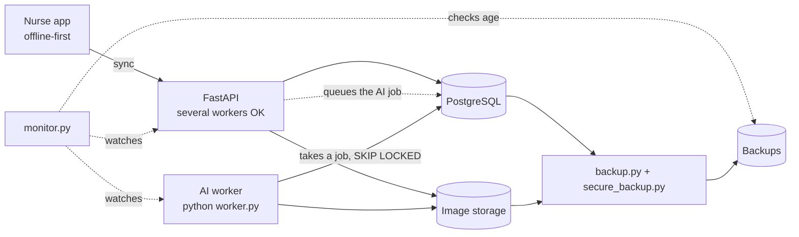

| Area | What exists | Command or file |
|---|---|---|
| **Backups** | Nightly dump of the database plus images, a manifest with checksums, test-restore into a throwaway database, keeps the last 14 | `python backup.py run \| list \| verify \| restore <folder> --yes` |
| **Encrypted backups** | AES-256-GCM, password-derived key, round-trip verified before the plaintext is removed | `python secure_backup.py encrypt backups` / `decrypt <path>` |
| **Migrations** | Alembic. Take a backup first, read the generated file, apply | `alembic revision --autogenerate -m "..."` then `alembic upgrade head` |
| **Health** | `/health` (alive), `/health/ready` (database, storage and model; 503 when degraded) | open in a browser |
| **Logs** | Rotating JSON lines with request IDs; optional Sentry | `backend/logs/api.log` |
| **Alerts** | Windows popup when the API, disk, backup age or AI worker is unhealthy | `python monitor.py` (`check` for a one-off) |
| **AI queue** | Uploads return at once; a worker runs the AI; 3 retries with backoff; crashed jobs are recovered; failed jobs have a Retry button | `python worker.py`, `AI_MODE=inline` for one terminal |
| **Scaling** | Several API workers are safe: login throttle in the database, paged lists (`?limit=&offset=`, total in `X-Total-Count`), indexes, one-minute analytics cache, locked startup | `python -m uvicorn main:app --workers 2` |
| **Tests and CI** | pytest against a throwaway database, GitHub Actions (backend, frontend, secret and dependency scan) | `pytest` in `backend` |
| **Secrets** | Weak or default secrets are flagged; production refuses to start with them; the token key rotates without signing anyone out | `python secrets_check.py`, `JWT_SECRET_OLD` |
| **Compliance** | Intended use, CDSCO, ICMR and DPDP notes; versioned consent; patient data export; erasure by anonymising | [docs/COMPLIANCE.md](docs/COMPLIANCE.md), `python manage.py anonymize-patient P001` |

### Security in one place
- Every API endpoint needs a valid token (an automated sweep checks all of them with no token, a garbage token and a wrong scheme).
- Staff see only their own centre; doctors see only cases assigned to them; patients see only their own released reports.
- Passwords: PBKDF2-SHA256 (600,000 rounds), a policy, temporary passwords shown once, forced change at first sign-in, lockout after 5 failures per account and 20 per address, uniform responses for unknown users.
- Tokens last 30 minutes, are renewed while the app is in use, and die when the password changes or the account is disabled.
- Uploads: size limits, image header checks, stored type taken from the file itself. Security headers and a content security policy on every response.
- Presigned image links expire after 15 minutes. The audit log is hash-chained, so edits are detectable (`GET /audit/verify`).

### Before a review or demo
Follow the checklist at the end of the runbook (backup and verify, tests green, secrets clean, one full journey, one offline test, `git tag review-3`).

### Known operational limits
- Deployment today is local (Docker for the database and storage). **HTTPS and a full containerised deployment are not done yet.**
- Backups are on the same machine unless you copy them away; encrypted backups protect a lost drive, not a stolen whole computer.
- The token is stored in the browser (mitigated by the content security policy); there is no two-factor sign-in.
- The AI queue lives in the database: right for thousands of cases a day; beyond that, a dedicated queue is the next step.
- The nurse app needs a connection for the first page load; opening it fully offline from a cold start (a service worker) is not implemented.

---

## ❓ Troubleshooting & FAQ

<details>
<summary><b>The API cannot connect to the database ("role dr does not exist")</b></summary>

A native PostgreSQL on Windows may already be using port 5432. This project's database is mapped to **5433** on purpose; check that `DB_URL` in `backend/settings.py` uses `127.0.0.1:5433`.
</details>

<details>
<summary><b>I changed a database model and the API fails with "column does not exist"</b></summary>

`create_all` does not alter existing tables. Add an `ALTER TABLE … ADD COLUMN IF NOT EXISTS` at startup, or wipe the dev database: `docker compose down -v` then `docker compose up -d`.
</details>

<details>
<summary><b>The web app says "Cannot reach the server"</b></summary>

Check that uvicorn is running, that `frontend/.env.local` has `NEXT_PUBLIC_API_URL`, and that you restarted `npm run dev` after creating it.
</details>

<details>
<summary><b>The doctor sees "AI results are not available yet"</b></summary>

AI runs on the server when the nurse's record **syncs after Send to doctor**. Open *Offline Queue & Sync* on the nurse side and sync.
</details>

<details>
<summary><b>A good photo was rejected for compression</b></summary>

The file's JPEG quality is below 80, often because it was forwarded through a chat app. Capture again, or export the original file from the camera.
</details>

<details>
<summary><b>Why is a patient graded "No DR" but flagged Referable?</b></summary>

Referral uses the summed probability of moderate-or-worse (threshold 0.09), not just the top grade. This is intentional, to keep sensitivity high.
</details>

<details>
<summary><b>I don't know the first password</b></summary>

There are no default passwords. On a fresh database the API terminal prints a table of temporary passwords once. Otherwise run `python manage.py reset-password <username>` (or `reset-patient P001`) in the `backend` folder. New staff get theirs from the administrator, new patients from the nurse.
</details>

<details>
<summary><b>"Too many wrong attempts"</b></summary>

The account is locked for 10 minutes after 5 wrong passwords. Wait, or have it reset by the administrator (staff) or a nurse (patients), which also unlocks it.
</details>

<details>
<summary><b>The doctor sees "AI results are not available yet"</b></summary>

The AI runs in a separate worker. Check that `python worker.py` is running. Waiting cases are processed as soon as it starts. See the runbook, section 3.
</details>

<details>
<summary><b>A doctor does not see a case</b></summary>

Each case goes only to the doctor the nurse chose. The nurse can change the doctor from *Screening Results* until the review is recorded. Cases sent before this feature existed are visible to every doctor of the centre.
</details>

---

<div align="center">

**BIS586 Mini Project · Group 10** · Guide: Prof. Krupesha · RV Institute of Technology and Management

Aditya S , Varsha Madyalkar , Jagan Sai K , M Jaiswaroop

</div>